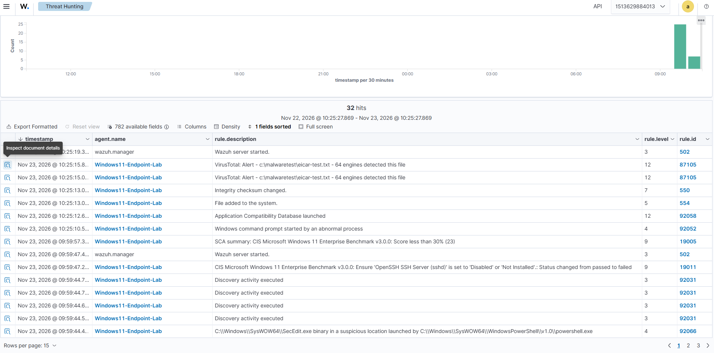
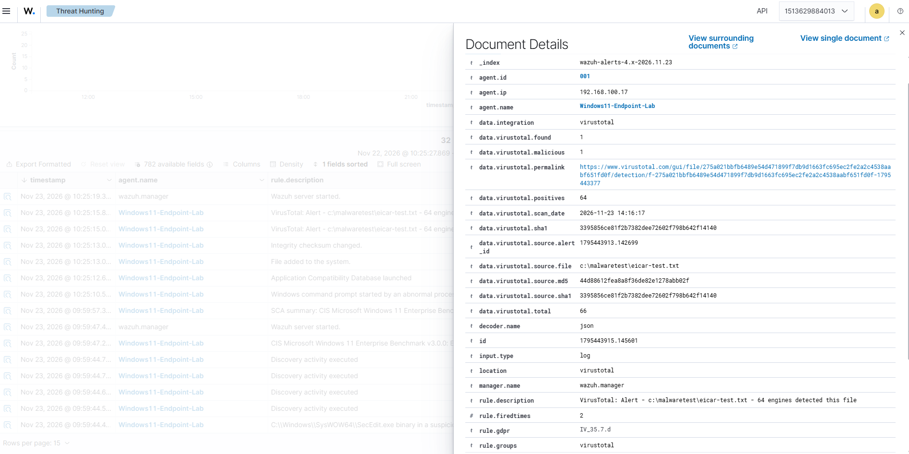

# 🤖 Automated Threat Intelligence & Malware Detection (Wazuh FIM + VirusTotal API)

## 📌 Project Overview
Manual hash lookups slow down Tier 1 SOC triage. This project implements an automated **Security Orchestration, Automation, and Response (SOAR)** enrichment workflow by integrating **Wazuh File Integrity Monitoring (FIM)** with the **VirusTotal Public API**. Whenever a new or modified file appears in a monitored Windows 11 directory, Wazuh automatically extracts its SHA-256 hash, queries over 70 antivirus engines via VirusTotal, and triggers a high-severity alert if malicious consensus is detected.

---

## 🏗️ Architecture & Workflow
1. **Real-Time File Monitoring (`SysCheck`):** Wazuh Agent on **Windows 11 Pro** (`Windows11-Endpoint-Lab`) monitors `C:\MalwareTest` with `realtime="yes"`.
2. **Automated Hash Extraction:** Upon file creation, FIM triggers **Rule `554`** (`File added to the system`) and **Rule `550`** (`Integrity checksum changed`), computing MD5/SHA-1/SHA-256 hashes.
3. **API Enrichment (`wazuh-integratord`):** Wazuh Manager intercepts the `syscheck` event and queries the VirusTotal API (`configs/virustotal_integration.xml`).
4. **High-Severity Alerting:** VirusTotal returns multi-engine detection metrics, firing **Rule `87105` (Level 12)** with direct forensic links.

---

## 🔍 Validation & Detection Results

### 1. Real-Time FIM & VirusTotal Alert Chain
To safely validate the pipeline without deploying live malware, the industry-standard **EICAR** test string was written to the monitored directory. Within seconds, Wazuh correlated the file creation (`Rule 554`), checksum calculation (`Rule 550`), and VirusTotal positive match (`Rule 87105` — **64 antivirus engines detected**):

### 2. Automated Threat Intelligence Enrichment Details (`Rule 87105`)
Expanding the Level 12 alert displays structured intelligence fields injected directly into the SIEM event (`virustotal.positives`, `virustotal.total`, `virustotal.permalink`, and `syscheck.sha256_after`), eliminating manual Tier 1 lookup overhead:

---

## 🛡️ SOC Response & Hardening Recommendations
1. **Automated Containment (Active Response):** Pair `Rule 87105` with a custom Wazuh Active Response script to automatically quarantine or delete confirmed malicious binaries (`positives >= 5`).
2. **API Key Security:** Store API keys with restricted file permissions (`640 root:wazuh`) and never commit credentials to version control.
3. **Scope Expansion:** Extend real-time FIM monitoring to high-risk user staging paths (`C:\Users\*\Downloads`, `C:\Users\*\AppData\Local\Temp`).
